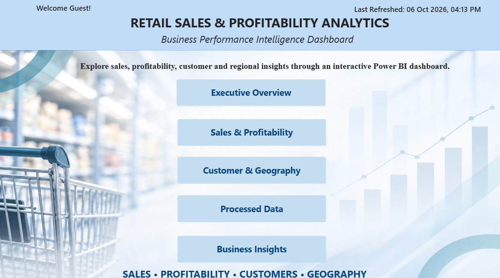
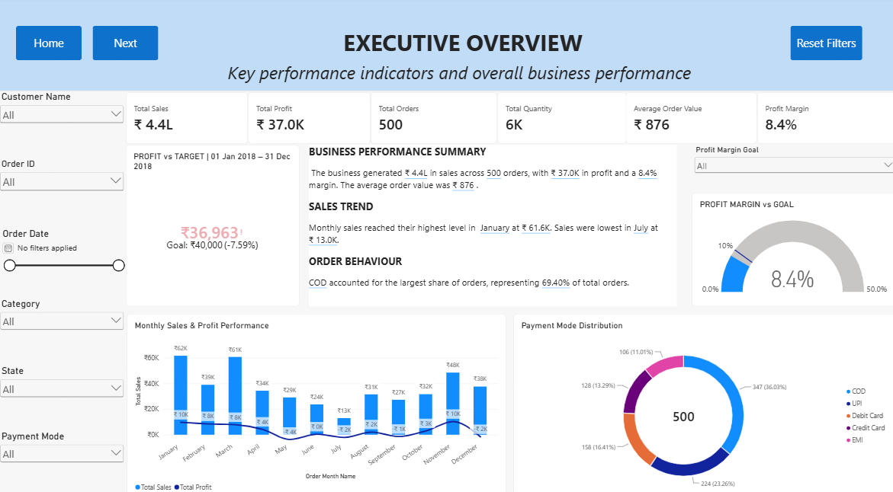
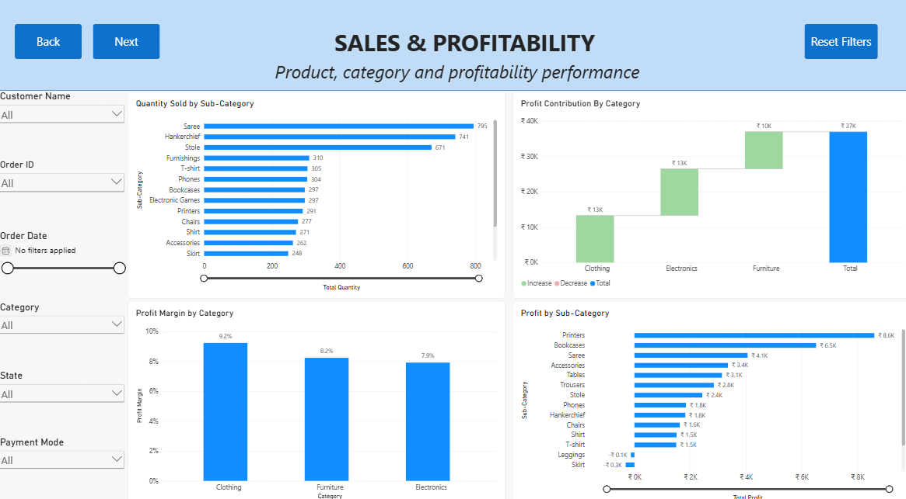
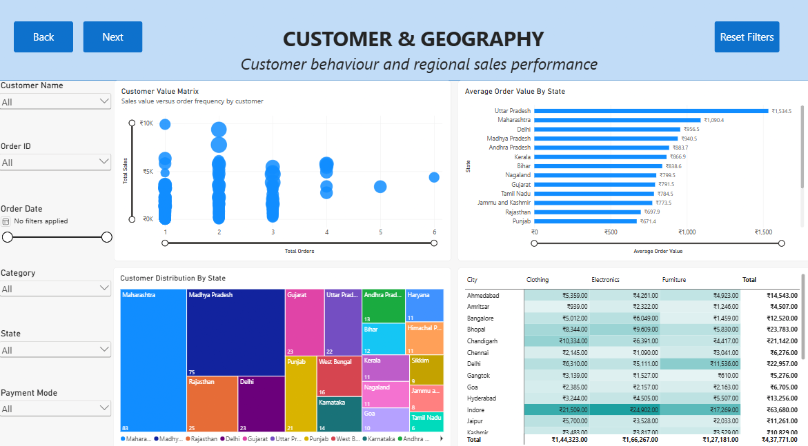
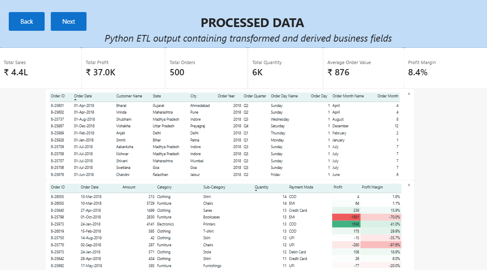
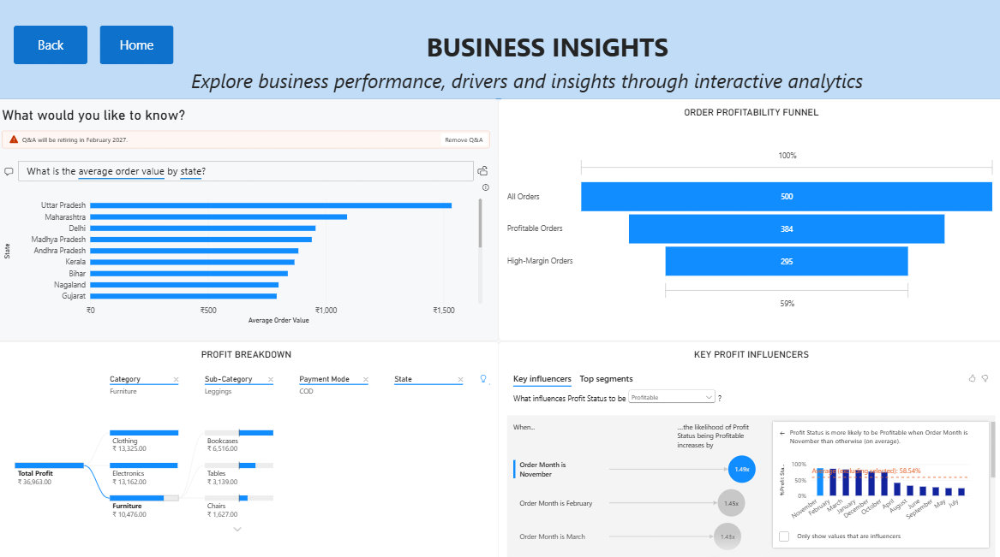
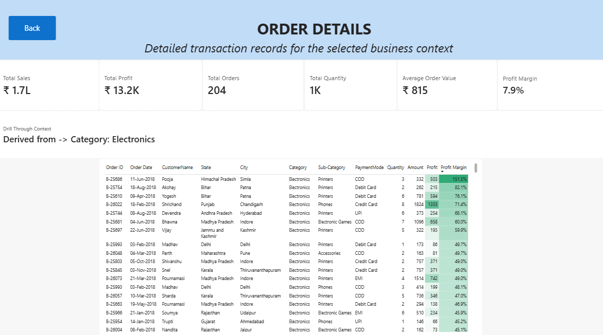

````markdown
# Retail Sales & Profitability Analytics

An interactive Business Intelligence dashboard built using **Power BI, DAX, Power Query, and Python** to analyze retail sales, profitability, customer behavior, geographic performance, and order-level insights using historical retail transaction data from 2018.

The project demonstrates an end-to-end analytics workflow, covering data preparation, ETL, data transformation, Power BI modeling, DAX calculations, interactive visualization, advanced analytics, and business insights.

---

## 📌 Project Overview

The project transforms raw retail transaction data into an interactive Power BI dashboard designed to help users understand business performance and investigate the factors influencing sales and profitability.

The dashboard allows users to:

- Monitor overall sales and profitability
- Track key business KPIs
- Compare profit against a dynamic target
- Analyze category and sub-category performance
- Identify profitable and high-margin orders
- Analyze customer and geographic performance
- Understand payment-mode distribution
- Investigate monthly business trends
- Explore business insights using advanced Power BI visuals
- Drill through from summary-level analysis to detailed transactions
- Access additional contextual information through custom tooltip pages

### Overall Workflow

```text
Raw Retail Data
       ↓
Python ETL
       ↓
Data Cleaning & Transformation
       ↓
Processed Data
       ↓
Power BI Data Model
       ↓
DAX Measures & Calculations
       ↓
Interactive Dashboard
       ↓
Business Insights
````

---

# 🛠️ Technologies Used

| Technology       | Purpose                                                                        |
| ---------------- | ------------------------------------------------------------------------------ |
| **Power BI**     | Dashboard development, visualization, data modeling, and interactive analytics |
| **DAX**          | Measures, calculated columns, dynamic KPIs, targets, and business logic        |
| **Power Query**  | Data transformation and preparation                                            |
| **Python**       | ETL and data preprocessing                                                     |
| **Pandas**       | Data manipulation and transformation                                           |
| **Git & GitHub** | Version control and project management                                         |

---

# 📁 Project Structure

```text
Retail-Sales-Profitability-Analytics/
│
├── data/
│   ├── Details.csv
│   ├── Orders.csv
│   ├── Details_ETL_Processed.csv
│   └── Orders_ETL_Processed.csv
│
├── etl/
│   └── etl.py
│
├── powerBi/
│   └── dashboard.pbix
│
├── Screenshots/
│   ├── Home.png
│   ├── Executive-Overview.png
│   ├── Sales-Profitability.png
│   ├── Customer-Geography.png
│   ├── Processed-Data.png
│   ├── Business-Insights.png
│   └── Order-Details.png
│
└── README.md
```

---

# 📊 Dashboard Structure

The Power BI dashboard consists of the following pages:

1. Home
2. Executive Overview
3. Sales & Profitability
4. Customer & Geography
5. Processed Data
6. Business Insights
7. Order Details

The Power BI file also contains **8 dedicated tooltip pages** used throughout the dashboard.

---

# 🏠 1. Home

The Home page acts as the landing page of the dashboard.

It provides navigation to the different analytical sections and serves as the starting point for users exploring the dashboard.



---

# 📈 2. Executive Overview

The Executive Overview provides a high-level summary of business performance.

## Key Performance Indicators

The page contains the following primary KPIs:

* Total Sales
* Total Profit
* Total Orders
* Total Quantity
* Average Order Value
* Profit Margin

These provide an immediate overview of the selected business context.

## Additional Analysis

The page also includes:

* Dynamic Business Performance Narrative
* Monthly Sales & Profit Trend
* Payment Mode Distribution
* Dynamic Profit vs Target KPI
* Profit Margin Goal Gauge
* Interactive Date and Business Filters
* Reset Filters functionality



---

## Dynamic Profit vs Target KPI

A dynamic KPI was developed to compare **profit generated during the selected period against a proportional profit target for the same period**.

The KPI does not simply compare the latest month's profit against an annual target.

Instead, it dynamically responds to the date range selected by the user.

### KPI Logic

A full-period benchmark is defined and then adjusted according to the selected date range.

```text
Annual Profit Benchmark
        ↓
Selected Date Range
        ↓
Number of Selected Days
        ↓
Proportional Target
        ↓
Actual Profit vs Target
```

For example:

```text
Full-Year Target
      ↓
Jan–Jun Selected
      ↓
Target Adjusted for Jan–Jun
      ↓
Jan–Jun Actual Profit vs Jan–Jun Target
```

This ensures that the actual profit and target always represent the same time period.

### Dynamic KPI Title

The KPI title also changes according to the selected date range.

For example:

```text
PROFIT vs TARGET | 01 Jan – 19 Aug 2018
```

This provides context to the KPI and prevents the displayed values from being ambiguous.

---

## Profit Margin Goal Gauge

A dynamic **Profit Margin Goal** parameter allows users to select a desired profit margin target.

The Gauge compares:

```text
Actual Profit Margin
        vs
Selected Profit Margin Goal
```

The target can be changed interactively through the dashboard.

This allows users to evaluate profitability under different target scenarios without modifying the underlying calculations.

---

# 📊 3. Sales & Profitability

The Sales & Profitability page focuses on product, category, and profitability analysis.

## Visualizations

* Quantity by Sub-Category
* Profit Contribution by Category
* Profit Margin by Category
* Profit by Sub-Category



---

## Waterfall Analysis

The **Profit Contribution by Category** Waterfall chart shows how different product categories contribute to the overall profit.

The visualization provides a contribution-based view of profitability rather than simply displaying separate category values.

It helps answer:

> Which categories contribute most to the overall profit?

The Waterfall complements the other profitability visuals by providing a clear view of how category-level contributions build toward the total profit.

---

# 🌍 4. Customer & Geography

The Customer & Geography page focuses on customer value and geographical performance.

## Analysis Areas

* Customer Value Matrix
* Average Order Value by State
* Customer Distribution by State
* City × Category Sales Matrix
* Geographic performance analysis

This page allows users to investigate how business performance varies across customers, states, cities, and product categories.



---

# 🗃️ 5. Processed Data

The Processed Data page provides visibility into the transformed datasets used by the Power BI model.

It contains:

* Processed Orders Data
* Processed Order Details
* Relevant analytical fields
* KPI-related information

This page demonstrates the connection between the ETL process and the final Power BI analytical model.



---

# 💡 6. Business Insights

The Business Insights page contains advanced Power BI analytical features that go beyond standard charts and KPI cards.

## Features

* Power BI Q&A
* Decomposition Tree
* Key Influencers
* Order Profitability Funnel



---

## Power BI Q&A

The Q&A feature allows users to explore the dataset using natural-language questions.

Users can ask questions related to:

* Sales
* Profit
* Orders
* Categories
* Sub-Categories
* Customers
* Geography
* Payment Modes

This provides an additional interactive method of exploring the data.

---

## Decomposition Tree

The Decomposition Tree is used to investigate factors contributing to overall profit.

Users can progressively break down profit across different dimensions.

An example analytical path is:

```text
Total Profit
     ↓
Category
     ↓
State
     ↓
Payment Mode
```

This enables users to interactively investigate where profit is being generated.

---

## Key Influencers

The Key Influencers visual is used to identify factors associated with profitable orders.

The analysis evaluates:

```text
Profit Status → Profitable
```

against explanatory fields including:

* Category
* Sub-Category
* Payment Mode
* Quantity
* Order Month

The visual identifies factors associated with a higher likelihood of an order being classified as profitable.

These results represent associations in the dataset and should not be interpreted as causal relationships.

---

# 🔻 Order Profitability Funnel

The dashboard includes an **Order Profitability Funnel** that analyzes orders through three nested stages.

```text
All Orders
     ↓
Profitable Orders
     ↓
High-Margin Orders
```

## Funnel Stages

### 1. All Orders

Represents all unique orders within the selected context.

### 2. Profitable Orders

Represents orders where:

```text
Profit Status = Profitable
```

### 3. High-Margin Orders

Represents profitable orders where:

```text
Profit Margin ≥ 20%
```

The funnel therefore represents a progressively narrower subset of orders:

```text
All Orders
     ↓
Orders generating positive profit
     ↓
Orders achieving a 20%+ profit margin
```

The funnel provides:

* Order count
* Percentage of first stage
* Percentage of previous stage

This allows users to understand both overall and stage-to-stage profitability progression.

---

# 🔎 7. Order Details

The Order Details page provides transaction-level analysis using Power BI drill-through functionality.

Users can navigate from summary-level analysis to detailed order information.

## Detail Information

The page provides information such as:

* Order ID
* Customer
* Category
* Sub-Category
* Sales
* Profit
* Quantity
* Profit Margin
* Profit Status
* Order Date
* Payment Mode



---

# 💬 Custom Tooltip Pages

The dashboard contains **8 dedicated tooltip pages** that provide additional contextual information when users hover over relevant dashboard visuals.

## Tooltip Pages

1. **TT - Payment Mode**
2. **TT - Category**
3. **TT - State**
4. **TT - Customer**
5. **TT - City Category**
6. **TT - Monthly Performance**
7. **TT - Sub-Category Quantity**
8. **TT - Sub-Category Profit**

These tooltip pages allow additional analytical information to be displayed without overcrowding the primary dashboard pages.

The tooltip pages are embedded directly inside the Power BI `.pbix` file.

---

# ⚙️ Advanced Power BI Features

The dashboard incorporates several advanced Power BI capabilities.

## Dynamic Features

* Dynamic Profit vs Target KPI
* Dynamic Profit Margin Goal
* Dynamic KPI date-period title
* Dynamic Business Performance Narrative

## Advanced Visual Analytics

* Waterfall Chart
* Order Profitability Funnel
* Decomposition Tree
* Key Influencers
* Q&A
* KPI Visual
* Gauge Visual

## Interactive Features

* Drill-through
* Interactive slicers
* Reset Filters
* Context-sensitive analysis
* Custom tooltip pages
* Dynamic filtering
* Role-based filtering

---

# 🔄 ETL Workflow

The project includes a Python-based ETL workflow for preparing the retail data before analysis in Power BI.

The ETL process transforms the source datasets into processed datasets used by the Power BI data model.

## ETL Workflow

```text
Raw Data
   ↓
Data Loading
   ↓
Data Cleaning
   ↓
Data Transformation
   ↓
Derived Fields
   ↓
Processed Data
   ↓
Power BI Data Model
```

The Python ETL implementation is available in:

```text
etl/etl.py
```

The processed datasets are stored in:

```text
data/
```

including:

```text
Details_ETL_Processed.csv
Orders_ETL_Processed.csv
```

---

# 📐 Data Model & Analytical Calculations

The Power BI model uses DAX measures and calculated fields to support the analytical requirements of the dashboard.

Examples include:

* Total Sales
* Total Profit
* Total Orders
* Total Quantity
* Average Order Value
* Profit Margin
* Profit Status
* Profit Target
* Selected Period Profit
* Selected Period Profit Target
* Profit Margin Goal

Date-related fields are used to support:

* Monthly trend analysis
* Dynamic period calculations
* Date-based filtering
* Period-specific KPI calculations

---

# 🎯 Business Analysis Areas

The dashboard focuses on several core business questions.

## Sales Performance

* How much revenue is being generated?
* How does sales performance change over time?
* Which categories contribute most to sales?
* Which sub-categories contribute to business performance?

## Profitability

* How much profit is being generated?
* Which categories are most profitable?
* Which sub-categories contribute most to profit?
* Which orders are profitable?
* Which orders achieve high profit margins?
* Is profit performance above or below the selected target?

## Customer Analysis

* Which customers generate higher value?
* How does average order value vary across locations?
* How is customer distribution spread geographically?

## Geographic Analysis

* Which states contribute more to business performance?
* How does performance vary across cities?
* How does category performance differ geographically?

## Payment Analysis

* Which payment modes are used most frequently?
* How is payment behavior distributed across the business?

## Order-Level Investigation

* Which individual orders contribute to profitability?
* What are the characteristics of profitable orders?
* Which orders achieve high profit margins?

---

# 🖼️ Dashboard Screenshots

## Home


## Executive Overview


## Sales & Profitability


## Customer & Geography


## Processed Data


## Business Insights


## Order Details


---

# 🚀 How to Use the Project

## Prerequisites

To explore or modify the project, install:

* Microsoft Power BI Desktop
* Python 3.x
* Pandas

---

## 1. Clone the Repository

```bash
git clone https://github.com/Badriii2502/Retail-Sales-Profitability-Analytics.git
```

Navigate to the project:

```bash
cd Retail-Sales-Profitability-Analytics
```

---

## 2. Run the ETL Process

Navigate to the ETL directory:

```bash
cd etl
```

Run the Python ETL script:

```bash
python etl.py
```

The processed datasets will be generated for use in the Power BI model.

---

## 3. Open the Power BI Dashboard

Open:

```text
powerBi/dashboard.pbix
```

using **Microsoft Power BI Desktop**.

---

## 4. Explore the Dashboard

Use the navigation buttons and interactive filters to explore:

* Executive Overview
* Sales & Profitability
* Customer & Geography
* Processed Data
* Business Insights
* Order Details

The dashboard includes interactive slicers, custom tooltips, drill-through functionality, advanced analytics, and dynamic KPI calculations.

---

# 📈 Example Analytical Flow

A typical analytical journey through the dashboard can follow this path:

```text
Executive Overview
        ↓
Identify Profitability Trend
        ↓
Sales & Profitability
        ↓
Identify Category / Sub-Category
        ↓
Business Insights
        ↓
Decomposition Tree / Key Influencers
        ↓
Order Details
        ↓
Investigate Individual Transactions
```

This allows the dashboard to support both **high-level management analysis** and **detailed transaction-level investigation**.

---

# 📌 Project Highlights

## Data Preparation

* Raw retail data processing
* Python-based ETL
* Data cleaning and transformation
* Derived analytical fields
* Processed datasets for Power BI

## Business Intelligence

* Power BI data modeling
* DAX measures
* Dynamic KPIs
* Dynamic target comparison
* Profitability analysis

## Data Visualization

* KPI Cards
* KPI Visual
* Gauge
* Waterfall Chart
* Funnel Chart
* Bar Charts
* Line Charts
* Donut Charts
* Matrices
* Interactive Slicers

## Advanced Analytics

* Q&A
* Decomposition Tree
* Key Influencers
* Dynamic Narrative
* Drill-through
* 8 Custom Tooltip Pages
* Dynamic Profit vs Target
* Dynamic Profit Margin Goal

---

# 🎯 Project Objective

The primary objective of this project is to demonstrate how raw retail transaction data can be transformed into an interactive Business Intelligence solution capable of supporting business analysis and decision-making.

The project combines:

```text
Data Engineering
       +
Data Analysis
       +
Business Intelligence
       +
Data Visualization
```

to create an end-to-end analytics workflow.

---

# 👤 Author

## Badrinarayan B

**B.Tech – Computer Science and Business Systems**
SRM Institute of Science and Technology

---

# 📄 Dataset Note

This project uses historical retail transaction data covering the **2018 calendar year**.

The dashboard and associated analysis are intended for **educational, analytical, and portfolio purposes**.

---

# ⭐ Project Status

**Completed**

The current version contains:

* Complete Python ETL workflow
* Processed datasets
* Power BI dashboard
* DAX-based analytical calculations
* Dynamic KPIs
* Target-based analysis
* Profit Margin Goal Gauge
* Waterfall analysis
* Order Profitability Funnel
* Q&A
* Decomposition Tree
* Key Influencers
* Drill-through analysis
* Dynamic narrative
* 8 custom tooltip pages
* Interactive filtering and navigation
* Transaction-level analysis

```
```
